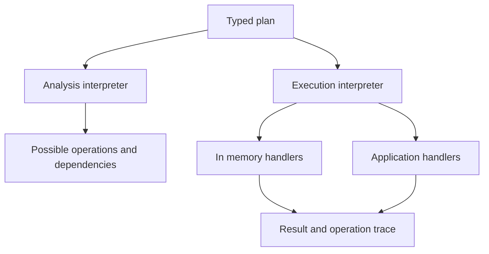

# OrdoFP next release: 0.1.4 foundations and 0.2.0 design

- **Date:** 2026-10-28
- **Status:** Implementation roadmap; proposed APIs require the acceptance evidence below.
- **Research baseline:** `01578e1e2782bc1ea78c141ea778931c4e0c0715` (2026-10-27).
- **First implementation task:** [Codex handoff](codex-handoff.md).
- **Evidence status:** Source inspection and primary-source research. The planning pass did not compile Rust, run tests, or produce benchmark results.

## Verification context at handoff

At handoff preparation, the implementation head matched the research baseline.
The tree at that revision has no
`.github/workflows` files. [CONTRIBUTING.md](../CONTRIBUTING.md) and the
[xtask implementation](../xtask/src/main.rs) specify local verification, while
[policies.md](policies.md) and [axioms.md](axioms.md) contain conflicting hosted-CI
claims. Use the executable local `cargo run -p xtask -- all` gate, record actual
results, and reconcile those documentation claims during maintenance. This plan
does not claim an existing green hosted run or require adding a CI service.

**Recommended direction:** ship a focused 0.1.4 maintenance release, then make 0.2.0 a toolkit for validated domain data, ownership-aware transformations, and explicitly controlled effects. The distinguishing research feature should be a small inspectable workflow layer built around selective functors. Keep the general effect kernel and incremental-computation experiments behind independent acceptance gates.

The core product promise can become: **Compose validated data and explicit operations into programs whose failure behavior, ownership costs, and execution requirements remain understandable as they grow.**

The [manifest](https://github.com/ordokr/ordofp/blob/01578e1e2782bc1ea78c141ea778931c4e0c0715/Cargo.toml) and [changelog](https://github.com/ordokr/ordofp/blob/01578e1e2782bc1ea78c141ea778931c4e0c0715/CHANGELOG.md) already record 0.1.3, with the changelog dated September 15, 2026; indexed package documentation also lists that version. GitHub release metadata still ends at 0.1.2. Treat 0.1.4 as the next maintenance target and reconcile release metadata before publication.

This design is grounded in the October 27 source revision linked throughout. API sketches describe proposed interfaces. Implementation acceptance requires compilation, downstream builds, and measured regression checks; no new performance result is asserted here.

## Product value and release goals

The existing [README](https://github.com/ordokr/ordofp/blob/01578e1e2782bc1ea78c141ea778931c4e0c0715/README.md) promises fewer invalid states, confidence in refactoring, optional costs, and stable Rust. The repository's [axioms](https://github.com/ordokr/ordofp/blob/01578e1e2782bc1ea78c141ea778931c4e0c0715/docs/axioms.md) already prioritize composition among proven subsystems and equal treatment of Latin and English APIs. That is the right direction to deepen.

| Existing promise | Next capability | Evidence required before claiming it |
| --- | --- | --- |
| Encode invariants in types | Checked domain constructors, nonempty invalid results, useful error locations, invariant-preserving updates | Invalid construction and reconstruction are rejected; round-trip and update properties hold |
| Refactor with confidence | Coherent public combinators across instances and compositions | Laws exercise exported operations, including failure, multiplicity, and ordering |
| Pay only for what is used | Ownership-sensitive APIs, explicit boxing, optional concurrency, unique-node reuse | Allocation and clone counts plus paired workload benchmarks |
| Stable Rust | A prototype-first approach to GATs, borrowing, and async callback bounds | The pinned MSRV and feature matrix compile the actual examples |
| Build understandable programs | Real and test interpreters, bounded execution, inspectable plans | A single application workflow runs with the intended effects and diagnostics |

A good flagship example is a batch importer: validate independent fields, build domain records, update persistent state through optics, compute summaries, and persist accepted changes through real or in-memory handlers. The same example should explain invalid input, shared snapshots, cancellation, and bounded concurrency. It should be usable from ordinary Rust without requiring the experimental effect layer.

Do not announce existing bridges as new. HList sequencing, iterator validation, fallible basic-lens modification, English aliases, Future/Stream interoperability, PFDS builders, and some ownership reuse already exist. The new value lies in completing their composition and improving their contracts.

## Source findings that determine priorities

These findings distinguish working foundations from gaps that affect the advertised guarantees.

| Area | Current source behavior | Release consequence |
| --- | --- | --- |
| Applicative sequencing | The default `ap_left` ignores the right context; `ap_right` ignores the left. Core instances inherit the defaults. `Some(1).ap_left(None)` therefore preserves the success. | Correct the known instance behavior in 0.1.4; remove invalid generic defaults in 0.2.0 |
| Trait sequencing | Trait-level `sequence_option` and `sequence_result` wrap existing elements instead of extracting nested effects. The free helper functions correctly use identity. | Deprecate misleading defaults if their signatures prevent a compatible correction; redesign the trait in 0.2.0 |
| Composed optics | Basic lenses have fallible modifiers. `ComposedAspectus` exposes only `get`, `set`, and `modify`. | Add fallible-method parity now; support consistent arbitrary-depth composition in 0.2.0 |
| Ownership ergonomics | Inherent validation maps require `FnMut` despite one invocation; `Seq::map` carries unnecessary input/output `Clone` bounds. | Relax bounds without adding a new subsystem |
| Validation representation | `Invalid` can contain an empty buffer, including through the public variant, `invalid_many`, and serde; a test preserves this behavior. | Nonempty invalid results require an explicit 0.2 representation and serialization change |
| Async execution | The supplied “parallel” vector traversal awaits sequentially. `Flumen` already implements `Stream`, but uses a boxed `Send + 'static` representation. | Add explicit bounded concurrency; make storage and thread-transfer choices visible in 0.2 |
| Async resources | `ResAsync` explicitly never invokes its stored release action. Separate `bracket_async` handles normal completion and documents cancellation/panic limits. | Correct maturity guidance now; redesign resource ownership in 0.2 |
| Generic Nexus | Generic get/put/ask/error operations are documented panic stubs; specialized state/reader/error computations work. Some proof-like marker constructors do not check their associated boolean claims. | Deliver one executable general path before expanding the effect vocabulary |

Sources: [Applicative](https://github.com/ordokr/ordofp/blob/01578e1e2782bc1ea78c141ea778931c4e0c0715/core/src/typeclasses/applicative.rs), [Traversable](https://github.com/ordokr/ordofp/blob/01578e1e2782bc1ea78c141ea778931c4e0c0715/core/src/traversable.rs), [lenses](https://github.com/ordokr/ordofp/blob/01578e1e2782bc1ea78c141ea778931c4e0c0715/core/src/optics/lens.rs), [validation](https://github.com/ordokr/ordofp/blob/01578e1e2782bc1ea78c141ea778931c4e0c0715/core/src/validated.rs), [Seq](https://github.com/ordokr/ordofp/blob/01578e1e2782bc1ea78c141ea778931c4e0c0715/core/src/pfds/seq.rs), [async traversal](https://github.com/ordokr/ordofp/blob/01578e1e2782bc1ea78c141ea778931c4e0c0715/core/src/async_core/traversable_async.rs), [streams](https://github.com/ordokr/ordofp/blob/01578e1e2782bc1ea78c141ea778931c4e0c0715/core/src/async_core/flumen.rs), [resources](https://github.com/ordokr/ordofp/blob/01578e1e2782bc1ea78c141ea778931c4e0c0715/core/src/async_core/res.rs), [Nexus operations](https://github.com/ordokr/ordofp/blob/01578e1e2782bc1ea78c141ea778931c4e0c0715/core/src/nexus/effect.rs), and [purity markers](https://github.com/ordokr/ordofp/blob/01578e1e2782bc1ea78c141ea778931c4e0c0715/core/src/nexus/optim/purity.rs).

Law tests are executable evidence for the exercised operations and instances. They do not prove arbitrary downstream trait implementations or make every helper correct automatically. Refinement constructors validate predicates at runtime; unrestricted interior mutability and user-defined cloning also limit claims that an arbitrary refined wrapper preserves a predicate forever. Keep these distinctions in user-facing contracts.

## Version 0.1.4 scope

### Correct public composition

Implement lawful `ap_left` and `ap_right` behavior for the affected instances, preserving failure propagation, validation error order, and Cartesian multiplicity. Add direct checks that the derived helpers agree with the underlying applicative operation. Compile against the existing signatures rather than strengthening method bounds silently.

For `Vec`, keeping the left value can repeat each left element according to the right vector's length without cloning right elements. Keeping the right values can use the existing whole-vector `Clone` bound, but its allocation behavior needs measurement. Cleaner bounds belong in 0.2.

Keep correct free sequencing helpers. Deprecate the incorrectly shaped trait defaults with a precise replacement path when correcting their signatures would break users.

### Complete inexpensive bridges

Add `modify_option`, `modify_result`, and `modify_validated` to the composed-lens type. Preserve its current return type and behavior in the patch. Add one example that composes a lens, validates a focused replacement, and retains the original source on failure.

Broaden inherent `Probatum::map/map2/map3` callbacks to `FnOnce` where each executes at most once. Remove unnecessary `Seq::map` clone constraints. These are direct improvements for ordinary owned Rust values.

### Align guarantees and evidence

Separate working specialized Nexus operations from unimplemented generic paths in the guide and maturity table. Correct the proof-like assertion contracts. In 0.1.4, either check the predicate they claim to assert or describe them as metadata; requiring a trait implemented for both true and false cases is not a proof.

Document the actual async resource and traversal behavior. Preserve public compatibility unless a concrete defect can be corrected within existing contracts. The repository's [standing policies](https://github.com/ordokr/ordofp/blob/01578e1e2782bc1ea78c141ea778931c4e0c0715/docs/policies.md) require downstream builds before public visibility or re-export changes.

Update maintenance documentation now; reconcile version and release metadata in the later release step. Run the existing canonical gate and add only tests needed for these concrete semantic risks. Do not use the patch release to introduce a new effect transport, change serialized validation shapes, or replace collection backends.

## Version 0.2.0 core composition

### Validation that produces useful domain values

Add a generic located-error envelope such as `Located<E>`, with field/index path segments and the caller's own error payload. Avoid forcing every error into a string. Field names can use static segments; dynamically indexed collections need a measured path representation.

Strengthen invalid-result representation with a private `NonEmptyErrors<E>` wrapper around the current error buffer. The conceptual public shape is:

```rust
// Proposed 0.2 shape, using the English API name.
enum Validated<E, A> {
    Valid(A),
    Invalid(NonEmptyErrors<E>),
}
```

Construction and deserialization must reject empty invalid collections. Keep the existing four-error inline-storage behavior structurally; a head-plus-tail redesign may change object size even if its advertised capacity remains four. Measure plain and located errors separately.

Use existing HList sequencing and iterator validation to accumulate independent errors. Once field validation succeeds, call a checked domain constructor for cross-field invariants. Keep that phase explicit: independent validation and dependent fail-fast construction have different semantics.

For example, validating start and end dates separately does not establish that start precedes end. An infallible generic reconstruction must not bypass the domain constructor. Raw DTOs may use generic conversion freely; invariant-carrying domain types need a checked `TryFrom` or equivalent construction boundary.

[Incremental integration with nutype](https://github.com/greyblake/nutype) is preferable to rebuilding a complete newtype macro framework. Nutype is an OSS reference for checked construction and validation during deserialization. User-defined unchecked derives remain outside those guarantees.

### Ownership aware combinators

Use `FnOnce` where the computation can call the callback at most once. Use `FnMut` for traversal over multiple values. Require cloning only where semantics actually duplicate a value.

The existing `Monad: Applicatio` relationship makes vector monadic operations inherit the cloning requirement of Cartesian application even when a consuming flat-map needs no clone. Prototype a small capability split for these cases. Do not create a second complete typeclass hierarchy merely to obtain naming symmetry.

The acceptance example should move a deliberately non-`Clone` payload through validation, sequencing, transformation, and an effect boundary. Borrowed read paths should keep their current zero-clone behavior.

For traversal, prototype a genuine applicative-family encoding on stable Rust against Option, Result, accumulating validation, and a multi-result instance before freezing the interface. Keep specialized helpers where they are simpler and clearer. [Karpal's current core](https://docs.rs/crate/karpal-core/latest) is a useful comparison for family encodings and generic traversal, not an automatic dependency.

### Optics whose capabilities survive composition

Choose a common contract for a total lens and its composed form so fallible updates and further composition remain available. Keep lens, affine, prism, and traversal cardinalities explicit; they have different laws.

Support borrowed inspection and validated replacement without cloning whole nested objects unnecessarily. Preserve the original source when a replacement fails. A generic optic setter must not bypass a refined wrapper's checked constructor.

Use English sketches in design discussions while assigning public scholastic names through the existing glossary. Both gateways should execute the same implementation and examples.

## Bounded async work and resource scopes

### Reuse the Rust async ecosystem

`Flumen` and `Futurus` already implement standard traits. The extension is to preserve concrete future/stream types where practical and expose explicit `.boxed()` and `.boxed_local()` boundaries. Local borrowing and optional thread transfer should not require every computation to be `Send + 'static`.

Reuse [futures-util buffering](https://docs.rs/futures-util/latest/futures_util/stream/trait.StreamExt.html) behind an optional async feature. Concurrent polling inside one task does not require spawning a task per item. CPU parallelism remains a separate Rayon concern.

The proposed policy surface is small:

| Operation | Failure behavior | Ordering and cancellation |
| --- | --- | --- |
| `validate_bounded` | Evaluate all selected inputs and accumulate errors | Return values and errors in input order; at most the configured number of in-flight futures |
| `try_traverse_bounded` | Stop admitting work on the first observed failure | Failure identity may depend on scheduling; retain its input index and drop remaining in-task futures |
| Explicit completion-order stream | Yield results as they become ready | Include provenance; make ordering a deliberate caller choice |

Use `NonZeroUsize` for the limit. Deterministic lowest-input-index failure would require waiting for unresolved earlier items, so it must not be conflated with immediate fail-fast behavior. Dropping a future stops polling it; it does not undo already issued external actions.

### A scope owns cleanup

Model resources around ownership: acquire, retain ownership, lend access to the use computation, then run finalization. Compose resources so partial acquisition failures release earlier acquisitions in reverse order. Keep cleanup failures alongside the original failure instead of silently replacing it.

[Cats Effect Resource](https://typelevel.org/cats-effect/docs/std/resource) and [Supervisor](https://typelevel.org/cats-effect/docs/std/supervisor) provide useful semantic references. Rust needs its own explicit lifecycle contract.

| Event | Required contract |
| --- | --- |
| Successful use | Await each registered async finalizer before returning completion |
| Use returns an error | Preserve the error and drain acquired resources |
| Later acquisition fails | Finalize earlier successful acquisitions |
| Cooperative cancellation | Stop work and let the still-running owner drain resources |
| Entire owner future is dropped | Synchronous destructors may run; async cleanup completion is not guaranteed |
| Executor shutdown or process abort | No unconditional async finalization guarantee |

Avoid a callback signature with one fixed `Fut` that is assumed to borrow a resource for every lifetime. Prototype a lending async callback, GAT-based callback, or explicit borrowed boxed future. Test local and sendable cases separately. [Rust's AsyncFnOnce documentation](https://doc.rust-lang.org/std/ops/trait.AsyncFnOnce.html) distinguishes stable async-callable bounds from nightly-only associated-type APIs.

This work should have its own gate. A remaining Nexus representation problem should not prevent the bounded traversal and resource improvements from shipping.

## A functioning ownership aware Nexus

Nexus should initially provide a small executable effect vocabulary: Reader, State, Error, Writer, and a user-defined request example. The same program must run under both a real interpreter and a deterministic in-memory interpreter.

### Semantic requirements

- Operations and response types are explicit.

- Handling an effect removes the corresponding tracked requirement.

- Execution is available when all required tracked operations have handlers.

- Resumption consumes its continuation; ordinary programs do not clone continuations.

- Resource identities distinguish two resources even when both store the same Rust type.

- Borrowing and `Send` restrictions follow actual captures and handlers.

- Error and state ordering are observable and tested.

- Boxing and dynamic dispatch are explicit storage choices.

Use existing HList/coproduct machinery where it reduces complexity. The current bitmask records effect categories and cannot alone distinguish two State resources. Private handles, handler-associated types, or deliberately generative scope tokens are more appropriate resource boundaries. Do not infer resource disjointness merely from two generic type parameters.

The [Affect paper](https://iris-project.org/pdfs/2025-popl-affect.pdf) motivates tracking one-shot versus multi-shot continuation usage. [Soundly Handling Linearity](https://blog.sigplan.org/2024/08/12/soundly-handling-linearity/) shows why unrestricted continuation duplication interacts badly with resource protocols. These results guide the API; their formal proofs do not transfer automatically to OrdoFP.

### Select one implementation

Prototype a simple reference interpreter and one optimized transport against identical operations and observations. Compare a CPS/evidence-passing approach with a compiler-generated async-state-machine approach during the experiment, then retain one production implementation.

[Corophage](https://github.com/romac/corophage) is the most relevant stable-Rust implementation reference for GAT-based resume values, borrowed programs, and explicit erasure. Its documented polling-context restrictions and dependency on fauxgen's private interface make it a reference to evaluate, not an unquestioned foundational dependency.

[Generalized Evidence Passing](https://www.microsoft.com/en-us/research/publication/generalized-evidence-passing-for-effect-handlers-or-efficient-compilation-of-effect-handlers-to-c/) is relevant to dispatch and fast paths. Porting Koka's compiler transformation is not a small library change.

A typed row describes operations performed through the API. It cannot prove that arbitrary Rust callbacks do not print, use atomics, panic, or loop. Avoid treating an empty row or `Fn` bound as whole-program purity or termination evidence.

Promote the new Nexus path only after real operations, deep composition, residual requirements, and resource behavior pass. Keep this independent from the stable-core release date.

## Inspectable plans as the research differentiator

Selective functors provide a focused capability between independent applicative composition and fully dependent monadic composition: a program can declare possible effects while deciding at execution time which branch to take. The [2019 paper](https://eprints.ncl.ac.uk/258640) and [reference implementation](https://github.com/snowleopard/selective) supply the semantic foundation.

The proposed `Plan` feature should store operation descriptions as data. Give it two interpreters:

1. An analyzer that lists possible operation kinds, dependencies, and branch structure.

2. An executor that runs only the selected branches using supplied handlers.

A first example could check whether configuration exists, load it when present, and otherwise construct defaults. Another is conditional account validation: business registration requirements apply only to business accounts.



An illustrative API contract is:

```rust
// Proposed interface concepts, not a compiled implementation.
let plan = config_plan(request_description);
let summary = plan.analyze();    // inspect declared possibilities
let result = plan.run(handlers); // consume the executable plan
```

Analysis must not execute operation nodes. Branches must be described or deferred; evaluating an effectful Rust argument before passing it to `select` has already performed the effect. Opaque closures remain opaque.

Start with a first-order operation vocabulary whose analysis is complete by construction. Report conditional operations as possibilities, not certainties. Resource names or costs that depend on runtime values should be represented as unknown or symbolic, not fabricated.

Keep dynamically dependent `flat_map` outside the completely inspectable subset, or explicitly mark the analysis boundary. Inspection is metadata about declared operations, not a security sandbox. Include terminal traces so tests can compare the intended behavior with actual interpreter actions.

Ship this as an opt-in 0.2 preview only if one useful workflow has both correct interpreters and law coverage. It should not hold the core release hostage.

## Persistent updates and later incremental computation

### Exploit unique ownership

OrdoFP already has AVL-based persistent sequences/maps, builders, structural sharing, and some `Arc::try_unwrap` reuse. Its recursive update paths still provide opportunities to avoid cloning uniquely owned node contents. [Seq](https://github.com/ordokr/ordofp/blob/01578e1e2782bc1ea78c141ea778931c4e0c0715/core/src/pfds/seq.rs) and [OrdMap](https://github.com/ordokr/ordofp/blob/01578e1e2782bc1ea78c141ea778931c4e0c0715/core/src/pfds/ord_map.rs) are the starting points.

Add or improve consuming update operations that reuse unique nodes and path-copy shared nodes. Preserve old snapshots exactly. Consider a batch-edit interface only if it improves on composing the owned operations; do not add a redundant builder.

The [Perceus research](https://www.microsoft.com/en-us/research/publication/perceus-garbage-free-reference-counting-with-reuse-2/) supplies the ownership-reuse inspiration. A Rust implementation using Arc uniqueness is not a port of its compiler or its garbage-freedom theorem.

Benchmark three distinct ownership regimes: one evolving collection, many retained snapshots, and repeated localized edits with large values. Compare standard Vec/BTreeMap, OrdoFP, [imbl](https://docs.rs/imbl/latest/imbl/), and [rpds](https://docs.rs/rpds/latest/rpds/). Measure clones, allocations, retained bytes, and time. RRB vectors, HAMTs, or Rc/Arc policies are follow-up choices only if those measurements justify them.

### Incremental derived values are a later extension

The existing [incremental effect](https://github.com/ordokr/ordofp/blob/01578e1e2782bc1ea78c141ea778931c4e0c0715/core/src/nexus/effects/incremental.rs) supports input dependencies and explicitly lacks a memo-to-memo dependency graph. A general incremental feature therefore needs graph correctness before an impressive performance story.

[DeCo, OOPSLA 2026](https://arxiv.org/html/2602.20866v1), supports incremental functional computation through explicit change structures and domain operations. Its first-order design and mechanized correctness provide a useful model for a small `Delta` contract. They do not imply automatic incrementalization of arbitrary Rust closures.

For a supported transformation, test the observational law:

```text
apply(f(x), delta_f(x, dx)) == f(apply(x, dx))
```

A practical future slice is an update to a persistent map plus maintenance of a derived aggregate. Start with explicit patches and full-recomputation comparison, then consider a [Salsa](https://github.com/salsa-rs/salsa) integration example for query dependency tracking. Defer a second general-purpose incremental engine and automatic derivation to a later release.

## Research and OSS integration decisions

### Academic work

| Research | Relevant result | OrdoFP transfer and release |
| --- | --- | --- |
| Van Rooij and Krebbers, Affect, POPL 2025, DOI 10.1145/3704841 | Affine tracking of continuation use | One-shot Nexus contracts and compile-fail tests in 0.2 |
| Tang, Hillerström, Lindley, and Morris, Soundly Handling Linearity, POPL 2024, DOI 10.1145/3632896 | Control-flow linearity matters when handlers duplicate or discard continuations | Restrict continuation reuse and specify resource behavior |
| Xie, Johnson, Maclaurin, and Paszke, Parallel Algebraic Effect Handlers, ICFP 2024, DOI 10.1145/3674651 | Handlers can preserve explicitly scoped independence | Later parallel Reader and branch-local Accum interpretation; no blanket parallel shared State |
| Böhler, Reinhard, Richter, and Mezini, DeCo, OOPSLA 2026, DOI 10.1145/3798264 | Explicit generic change structures with correctness results | A later typed-delta experiment with observational laws |
| Liell-Cock and Staton, Cambria, August 2026 preprint, arXiv 2608.27798 | Handlers abstract resource representations | Handler-owned opaque resource identities; emerging design guidance |
| Mokhov, Lukyanov, Marlow, and Dimino, Selective Applicative Functors, ICFP 2019, DOI 10.1145/3341694 | Static possible effects with dynamic selection | Optional inspectable Plan in 0.2 |
| Xie and Leijen, Generalized Evidence Passing, ICFP 2021, DOI 10.1145/3473576 | Implemented effect-handler compilation techniques | Dispatch experiments after a correct reference interpreter |
| Reinking, Xie, de Moura, and Leijen, Perceus, PLDI 2021, DOI 10.1145/3453483.3454032 | Reference counting and storage reuse | Measured consuming PFDS updates |

Primary sources: [Affect](https://popl25.sigplan.org/details/POPL-2025-popl-research-papers/5/Affect-An-Affine-Type-and-Effect-System), [Linearity](https://blog.sigplan.org/2024/08/12/soundly-handling-linearity/), [Parallel handlers](https://xnning.github.io/papers/icfp24parallel.pdf), [DeCo](https://arxiv.org/html/2602.20866v1), [Cambria](https://arxiv.org/abs/2608.27798), [Selective](https://eprints.ncl.ac.uk/258640), [Evidence passing](https://www.microsoft.com/en-us/research/publication/generalized-evidence-passing-for-effect-handlers-or-efficient-compilation-of-effect-handlers-to-c/), and [Perceus](https://www.microsoft.com/en-us/research/publication/perceus-garbage-free-reference-counting-with-reuse-2/).

For a parallel effect preview, limit the first implementation to immutable Reader and branch-local Writer/Accum. Preserve deterministic order for noncommutative logs. Require the relevant algebraic laws before reassociation, and specify floating-point reproducibility separately. A State label does not establish disjoint resources.

Cambria is an emerging preprint, not an established Rust dependency. Its transfer is resource abstraction; do not claim that phantom parameters alone reproduce its parametricity result.

### OSS choices

| Project | Use | Dependency decision |
| --- | --- | --- |
| [futures-rs](https://docs.rs/futures-util/latest/futures_util/stream/trait.StreamExt.html) | Bounded concurrent polling and explicit boxing/local boxing | Optional async integration |
| [nutype](https://github.com/greyblake/nutype) | Checked domain-construction and serde examples | Integration recipe; user chooses the macro crate |
| [Cats Effect](https://typelevel.org/cats-effect/docs/std/resource) | Resource and supervisor semantics | Design reference |
| [corophage](https://github.com/romac/corophage) | Stable Rust effect/resumption model and benchmarks | Reference first; assess transport constraints before dependency |
| [selective](https://github.com/snowleopard/selective) | Laws and inspectable conditional composition | Implement a small Rust subset |
| [imbl](https://docs.rs/imbl/latest/imbl/) and [rpds](https://docs.rs/rpds/latest/rpds/) | Collection comparison and interoperability | Dev benchmarks and optional adapters |
| [Karpal](https://docs.rs/crate/karpal-core/latest) | HKT family and traversal comparison | API reference |
| [id_effect](https://docs.rs/crate/id_effect/latest) | Typed capabilities, layers, scopes, and testing as a coherent user journey | Competitor/reference; importing its runtime would duplicate substantial infrastructure |
| [Salsa](https://github.com/salsa-rs/salsa) | Query-based incremental computation | Later adapter/example |

A new abstraction's existence in another project establishes a reference point, not demand or production readiness for OrdoFP. The recommendation is to reuse standard integration crates where they reduce code, and keep research-specific semantics small enough to verify locally.

## Architecture and implementation sequence

Keep the facade and existing core/macros/laws workspace. Start with focused module changes; a workspace-wide crate split would add coordination cost before demonstrating user value.

| Module area | Planned change |
| --- | --- |
| `typeclasses`, `traversable`, `laws` | Lawful derived combinators, ownership bounds, genuine sequence signatures, operation-level coverage |
| `validated`, `refined`, HList and generic construction | Located errors, nonempty invalid states, checked domain boundaries |
| `optics` | Composed-method parity, recursive composition with preserved capabilities |
| `pfds` | Consuming updates with unique-node reuse and shared-snapshot correctness |
| `async_core` | Bounded policies, explicit erasure, local borrowing, owned resource scopes |
| `nexus` | One executable operation/handler model and explicit tracked requirements |
| Optional `plan` module | First-order operation descriptions with analysis and execution interpreters |

Preserve zero third-party runtime dependencies for the default build and keep the current MSRV unless an explicit, justified release decision changes it. Bounded async support may add an optional dependency; it must not appear in the default runtime dependency graph. Keep Latin and English gateways on the same implementation.

### Milestones

1. **0.1.4:** correct affected combinators, complete composed-lens fallible modifiers, relax unnecessary ownership bounds, and align contract documentation.

2. **0.2.0 alpha 1:** freeze validation representation and core ownership changes after downstream compile checks.

3. **0.2.0 alpha 2:** integrate bounded async policies and the resource ownership design with cancellation tests.

4. **Independent Nexus checkpoint:** admit the general handler path only when real operations, borrowed values, and residual requirements work.

5. **Independent Plan checkpoint:** admit the preview only when analysis is non-executing and selected execution is correct.

6. **0.2.0 release candidate:** run the complete consumer/matrix/performance gate and publish the flagship workflow plus migration guide.

Do not attach a calendar promise before the two representation prototypes are compiled. Scope can be bounded by evidence: the stable-core milestone is releasable without experimental Plan or Nexus promotion.

### Changes that belong in the minor release

Record the nonempty invalid-state and serde change, corrected sequencing signatures, any typeclass capability split, changed stream representation, resource callback ownership, and replacement Nexus representation in the migration guide. Deprecate compatible paths in 0.1.x where useful; remove superseded internals in 0.2 instead of retaining two divergent implementations.

Preserve API compatibility in the maintenance release and build downstream path consumers before changing public exports, as required by the standing policy.

## Acceptance gates and priorities

### Required evidence

| Gate | Acceptance criteria |
| --- | --- |
| Algebraic behavior | Failure propagation, Cartesian cardinality, error order, and derived-combinator coherence agree with reference behavior |
| Domain invariants | Empty invalid values cannot be constructed through safe constructors or serde; checked domain reconstruction cannot be bypassed by the recommended workflow |
| Ownership | Representative non-Clone values and consuming closures compile; borrowed reads and explicit erasure have measured allocation behavior |
| Optics | Fallible methods survive composition; failed updates preserve the source; laws are checked at several nesting depths |
| Async bounds | In-flight count never exceeds the nonzero limit; accumulate-all ordering is deterministic; fail-fast error policy is documented and tested |
| Resource lifecycle | Success, failure, partial acquisition, cooperative cancellation, and cleanup error policies are exercised |
| Nexus | Real operation traces and results agree with the reference interpreter; missing handlers and double resume fail to compile |
| Plans | Analysis performs no described effects; unselected branches do not execute; possible-operation reports match the supported representation |
| Persistence | Old snapshots remain unchanged; unique/shared clone and allocation counts are compared separately |
| Release | Canonical xtask gate, stable MSRV, no_std/alloc/feature matrix, downstream builds, dependency audit, and paired performance checks pass |

Keep existing QuickCheck infrastructure. Add focused property generators or an optional shrinking framework only where a concrete state-history or cancellation failure needs better minimization. Compiler rejection, property testing, reference interpretation, and benchmarks answer different questions; report each accurately.

The benchmark suite should include the existing grade-processing workload, configuration/domain validation, shared-snapshot edits, bounded remote checks, and a small handler-heavy program. Record runtime, allocations, element clones, retained memory, build time, and binary/code-size effects where relevant. Set budgets from paired baselines and real consumer requirements; do not announce an unsupported speedup target.

### Priority order

**First:** restore core composition guarantees and remove unnecessary ownership friction.

**Second:** make validation, domain construction, optics, and persistent state feel like one toolkit.

**Third:** provide bounded async execution and a scope with an explicit lifecycle contract.

**Fourth:** finish the small Nexus kernel and release inspectable plans as a separately gated preview.

**Later:** typed deltas, dependency-graph integration, richer effect parallelism, and collection-backend changes supported by actual workloads.

Additional distributed scaffolding, a new executor, general multi-shot continuation machinery, blanket effect-based optimization, and wholesale compiler-port projects are outside this release. The release succeeds when a realistic program gains clearer invariants, fewer manual conversions, predictable failure behavior, and controlled costs from combining the existing strengths.
